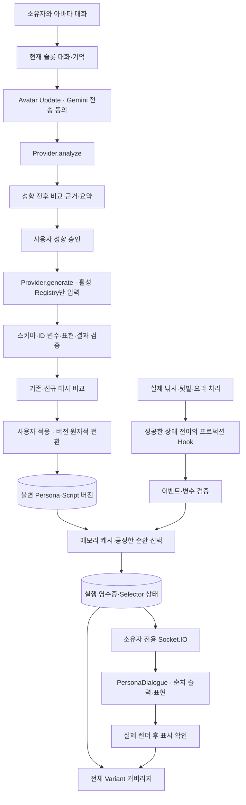

# ILLOVA Persona-Driven Event Script System

검증일: 2026-10-27 (Asia/Seoul). **구현·Fixture 전수 검증 및 실제 Gemini 생성 대사 전수 검증 완료**다. 실제 Gemini가 생성한 두 버전의 42개 대사 모두 게임플레이·일반/강제 선택·UI 출력 검증을 통과했다. 이전 HTTP 402는 결제 후 재실행에서 해소되었으며, Fixture 결과와 실제 LLM 결과를 구분해 보존한다.

## 기존 프로젝트 조사

React 19·Three.js·Vite 클라이언트, Express 5·Socket.IO·Node SQLite 서버를 사용한다. 테스트는 기존 `node:test`와 임시 SQLite DB를 재사용하며, UI 검증은 고정한 Playwright 1.62.1과 실제 빌드된 앱을 사용한다.

- 아바타: `server/app.mjs`의 밸런스·온보딩·자아 슬롯, `server/store.mjs`의 사용자 설정·기억·슬롯 스냅샷을 유지한다. 플레이어 캐릭터와 AI 아바타의 외형을 구분한다.
- 대화: `server/ai.mjs`의 Gemini JSON 추론과 권한 필터링된 기억 검색을 유지한다. 소유자 대화, 방문자 대화, 슬롯별 세션이 구분된다. PSS 분석은 현재 슬롯의 **소유자가 자신의 아바타에게 보낸 메시지** 최근 40개와 현재 기억 최대 30개만 사용한다. 방문자 원문은 포함하지 않는다.
- 저장: 기존 SQLite에 추가 테이블을 생성한다. 기존 기록을 삭제하거나 운영 DB에 테스트 계정을 만들지 않는다. 테스트는 메모리 DB 또는 별도 임시 파일을 사용한다.
- 이동·활동: 마을 이동·낚시·텃밭·요리는 실제 서버 상태와 활동 완료 영수증을 가진다. 숲 자원 채집 자체는 존재하지만 `EXPLORATION_COMPANION_AVAILABLE`이 꺼져 있으므로 AI에게 따라오기·채집·채광·벌목을 부탁하는 경로는 지원하지 않는다.
- UI·표현: 기존 아바타 초상화와 `happy/curious/calm/thinking/excited` 표현을 재사용한다. PSS 전용 말풍선은 초상화·아바타 이름을 표시하고 기존 채팅 말풍선과 독립적으로 순차 출력한다.
- 기존 빌드·CI: `npm run build`, `npm test`, Oracle CI/CD를 유지하고 Fixture 기반 브라우저 검증을 verify 작업에 추가했다. 실제 Gemini 검증은 CI 기본 실행에 포함하지 않는다.

## 아키텍처



생성 인터페이스는 `analyze(input)`·`generate(persona)`·`name`이다. 런타임 Selector는 이 인터페이스를 호출하지 않는다. Gemini 어댑터를 로컬/온디바이스 생성기로 교체할 수 있다. 키 누락·HTTP 실패·파싱 실패·검증 실패를 로컬 성공 대사로 대체하지 않는다.

### 상태 모델

| 계층 | 모델과 수명 | 변경 방식 |
|---|---|---|
| Persona | 사교성·다정함·호기심·장난기·감수성·활동 선호 0..1, 말투, 취향. 슬롯·버전별 저장 | LLM 제안 → 사용자 승인 → 생성·검증 → 적용 |
| Emotion | neutral/happy/sad/angry/tired/excited. 실제 연결은 활동 성공 happy, 실패 sad, 희귀 excited | 게임 이벤트에서 로컬 변경. 별도 감정 이벤트 생성은 미지원 |
| Relationship | `relationships.player`의 familiarity/affection/trust/sharedExperience. 대상별 키를 추가할 수 있는 구조 | 활동 경험에 따라 familiarity·trust 증가. affection 변화·아바타 간 관계 트리거는 아직 미지원 |

기존 밸런스·기억 구조를 교체하지 않는다. 기존 수치형 성향이 없으므로 새 수치는 중립값에서 시작하고, 기존 말투·공개 태그와 분석 근거를 재사용한다. 승인된 성향은 **소유자 전용 채팅 컨텍스트**에도 반영한다. 방문자 컨텍스트에는 비공개 PSS 성향을 넣지 않는다. Persona와 Script의 버전은 하나의 원자적 묶음으로 전환되며 각각 같은 버전 번호를 가진다.

### Event Registry와 실제 연결

`shared/personaScripts.mjs`의 각 항목은 ID, 트리거, 소스, 사전 조건, 변수, 런타임 상태, 변형 수, 출력 UI, 도달 상태를 가진다. 후보 이벤트 중 구현되지 않은 것은 `active:false`와 이유를 가진다. `bound`는 소스 연결 상태이며 테스트 PASS의 대용으로 사용하지 않는다.

| 활성 ID | 실제 소스 | 정상 플레이 조건·행동 | 변수 |
|---|---|---|---|
| fishing.start | `server/life.mjs` → insertSession | 마을 입장, 빈 낚시 자리까지 이동, E/낚시 버튼. 실제 세션 생성 | 없음 |
| fishing.result.success | settle → awardLifeFish | 진행 중인 낚시에서 45초 경과, 일반·고급 획득 | fishName |
| fishing.result.failure | settle → awardLifeFish | 진행 중인 낚시에서 45초 경과, 획득 실패 | 없음 |
| fishing.result.rare | settle → awardLifeFish | 진행 중인 낚시에서 45초 경과, 희귀·특별 획득 | fishName |
| garden.plant.complete | tick → gardening.complete | 자신의 마을, 빈 밭에 씨앗 심기, 이동·작업 완료 및 저장 성공 | 없음 |
| garden.harvest.complete | tick → gardening.complete | 실제로 성장한 작물에 수확 요청, 작업·보관함 반영 완료 | 없음 |
| cooking.complete | tick → gardening.complete | 실제 확보한 재료로 요리 요청, 조리·재료 소비·보관함 반영 완료 | 없음 |

이 대사들은 **플레이어가 수행한 활동에 대한 AI 아바타의 반응**이다. AI가 대신 낚시하거나 작업을 수락한 것처럼 보고하지 않는다. 자리 없음·거리 부족·다른 활동 중·아직 자라지 않은 밭 등 기존 거절 분기는 새 성공 이벤트를 발생시키지 않는다. 별도의 가짜 Accept/Reject 스크립트를 만들지 않는다.

미지원 34개는 AI 작업 요청 17개, 독립 감정 전이 8개, 일반 작업/발견 반응 4개, 소셜 반응 5개다. 정확한 ID·사유는 Registry와 전수 리포트의 `unsupportedEvents`에 수록한다. 새로운 이벤트는 실제 Hook·게임플레이 재현 케이스가 있어야 활성화할 수 있다.

### 생성·검증·버전 저장

각 활성 이벤트에 3개 대사를 요구한다. 이벤트 누락·중복·미지원 ID, Variant ID 중복, 같은 이벤트 내 동일 대사 중복, 허용되지 않은 필드·표현, 빈 문자열·100자 초과, 잘못된 중괄호·변수, outcome 불일치와 명백한 성공/실패 표현 모순을 거절한다. `fishName`은 실제 아이템 정의의 24자 이하 이름만 전달하며 렌더 결과는 160자 이하로 제한한다.

자연어 의미 검증은 outcome 메타데이터와 보수적인 한국어/영어 표현 규칙이다. 임의의 자연어 모순을 모두 증명하는 검증기는 아니다. 이번 실제 Gemini 생성 대사 42개의 문장도 확인했으며, 성공·실패·작업 완료의 의미와 Persona A의 존댓말에서 B의 반말로의 변화를 확인했다. 미래의 모든 LLM 출력에 같은 품질을 보장한다는 의미는 아니다.

| 테이블 | 저장 내용 |
|---|---|
| pss_versions | owner/slot/version별 불변 Persona·Script JSON, 제공자, 생성 시각 |
| pss_active | 현재 적용 버전 포인터 |
| pss_proposals | 근거 지문·기준 버전·제안·생성 후보·상태. 거절된 생성 JSON도 보존 |
| pss_selector | 버전·이벤트별 남은 순환 후보와 마지막 선택 |
| pss_runtime | 단기 감정·대상별 관계 |
| pss_executions | 정상 게임 소스 ID, 전역 Variant ID, 렌더된 텍스트·표현, 표시 확인 시각 |

모델이 생성하는 로컬 ID와 별도로 전역 ID를 `owner:slot:version:localVariantId`로 구성한다. 사용자·슬롯·버전이 달라도 충돌하지 않는다. 생성 중 대화·기억·슬롯·프로필 revision·현재 버전이 바뀌면 제안을 무효화한다. 동시 생성 잠금과 트랜잭션으로 중복 적용을 막는다. 적용·복구는 사용자 revision을 갱신해 기존 채팅 컨텍스트도 무효화한다. 실패하면 이전 버전 포인터를 유지한다. 롤백 후 신규 적용 번호는 저장된 최대 버전보다 크게 부여한다.

### 런타임·UI

활성 스크립트는 버전별로 캐시한다. 이벤트에서는 캐시 조회, 3개 후보 선택, 변수 치환, 실행 기록만 수행한다. 감정·관계는 순환 묶음의 선호 순서를 정하지만 후보를 영구 제외하지 않는다. 모든 변형이 묶음당 한 번 선택되고 연속 중복도 방지한다. 가중치 0·임의의 불가능 조건·모든 이벤트를 취소하는 쿨다운을 도입하지 않는다.

실제 낚시 정산 트랜잭션에 PSS 기록·Selector 상태를 포함한다. 재고·정산 저장 실패 시 대사 기록도 함께 롤백되고 소켓 전송은 커밋 이후에 한다. 같은 게임 소스 ID의 재시도는 중복 출력하지 않는다.

소유자 전용 소켓으로만 보내며 다른 사용자의 화면에 비공개 성향 대사를 브로드캐스트하지 않는다. `PersonaDialogue`는 현재 사용자·슬롯·버전을 검사한다. FIFO로 한 번에 한 대사를 6.5초 표시하며 다음 버튼을 제공한다. 말줄임 없이 줄바꿈하고, 표현은 기존 Scene 상태로 전달한다. 다른 패널을 열면 표시하지 않으며 미표시 영수증은 다음 표시 시 읽는다. 재접속 시 HTTP로 미표시 대사를 복구한다.

브라우저가 실제 렌더된 노드를 확인한 뒤 표시 acknowledgment를 저장한다. 이 서버 기록 자체가 독립적인 UI 검증 증거는 아니다. 브라우저 전수 테스트는 별도로 텍스트·실행 ID·화면 경계·잘림·스크린샷을 검사한다.

## 구현 파일

| 파일 | 역할 |
|---|---|
| shared/personaScripts.mjs | Registry, 세 계층의 열거형, 엄격한 생성 스키마, 렌더링, 공정한 Selector |
| server/pssProvider.mjs | Gemini 분석·생성 어댑터. 런타임과 분리 |
| server/personaScripts.mjs | 승인 API, 저장·버전·롤백, 실행·표시 영수증, 계정별 커버리지 API |
| server/life.mjs | 실제 생활 활동 Hook과 정산 원자성 |
| server/ai.mjs | 승인된 소유자 Persona를 기존 채팅에 반영 |
| server/app.mjs | PSS 설치, 실패 안내, 테스트용 명시적 publicOrigin 주입 |
| src/PersonaUpdate.jsx | 동의, 성향 비교, 승인, 대사 전후 비교, 적용·취소·복구 |
| src/PersonaDialogue.jsx | 아바타 초상화·이름·대사, 큐, 버전 분리, 표시 확인 |
| src/persona-scripts.css | 데스크톱·모바일 말풍선 및 비교 UI |
| src/main.jsx | Avatar Update 버튼·패널·말풍선·표현 연결 |
| shared/pssCoverage.mjs | 모든 생성 Variant의 분모 유지, 독립적인 실행/표시/강제/일반 선택 지표 |
| tests/pssFixtures.mjs | 차분한 Persona A와 다정하고 장난스러운 Persona B, 명시적 비LLM Fixture |
| tests/pssGameplay.mjs | Registry별 재사용 가능한 정상 활동 재현 경로 |
| tests/persona-scripts.test.mjs | 11개 기능·게임플레이·회귀 테스트 |
| tests/runtimeHarness.mjs | 기존 하네스에 선택적 포트 지정 추가 |
| scripts/verify-persona-scripts.mjs | 실제 빌드 앱의 전수 Playwright 검증·JSON/CSV/Markdown·스크린샷 생성 |
| package.json / package-lock.json | 테스트 명령과 Playwright 고정 |
| .github/workflows/oracle-cicd.yml | LLM 없는 브라우저 전수 검증 단계 |

## 재현 및 결과 파일

```sh
npm ci
npm run build
npm test
npm run test:pss
npm run test:pss:ui
# Windows는 설치된 Edge, Linux/CI는 아래 설치 후 Chromium 사용
npx playwright install --with-deps chromium
# 합성 대화만 사용하며 실제 Gemini 분석·생성도 검증
npm run test:pss:live
```

`test:pss:live`만 `.env`의 Gemini 설정을 읽는다. 기본 UI 검증과 단위 테스트는 외부 LLM을 호출하지 않는다. 브라우저 실행 파일은 `PSS_BROWSER_CHANNEL`, 외부 제공 Playwright는 `PLAYWRIGHT_MODULE`로 선택할 수 있다.

테스트 시계는 2026-10-27T00:00:00Z로 고정하고 결과 판정 난수를 고정 배열로 공급한다. 판정만 제어하고 실제 `rollFish`·재고 반영·활동 완료·Hook·Selector·소켓·React 출력을 우회하지 않는다. 이동·생활 활동은 프로덕션 Socket/HTTP 요청으로 재생하며, Avatar Update의 동의·승인·대사 비교·적용은 브라우저 버튼으로 수행한다. 씨앗은 실제로 심고 성장 시계를 전진한 뒤 수확한다. 요리 재료는 실제 낚시로 확보한다. 정상 플레이에서도 해당 확률 결과·성장 시간·재료 조건을 달성할 수 있다.

결과는 Fixture 검증의 `artifacts/pss/fixture/` 및 실제 LLM 검증의 `artifacts/pss/gemini/` 아래 `coverage.json`, `coverage.csv`, `coverage.md`, 개별 스크린샷에 생성된다. 최신 실제 Gemini 검증 요약과 전수 결과는 `docs/pss-results/coverage.*`에 보존하며 기존 Fixture 결과는 `fixture-coverage.*`로 구분한다. 각 행에 실제 게임 소스·실행 ID·스크린샷을 연결한다. 테스트 전용 강제 선택은 `testing:true`인 서버 옵션에서만 켤 수 있고 일반 Selector 실행과 별도 기록된다. HTTP로 임의 이벤트나 Variant를 발생시키는 테스트 전용 엔드포인트는 없다.

`GET /api/me/pss/coverage`는 현재 계정·슬롯의 **모든 적용 이력**과 거절된 생성 후보를 보고한다. 서버의 `clientAcknowledged`와 브라우저 검증 결과의 `uiDisplayed`를 구분한다. 도달 불가능하거나 잘못된 생성 Variant를 분모에서 빼는 회귀도 테스트한다.

## 검증 요약과 미완료 항목

- 전체 회귀: **373개 중 370개 통과, 실패 0, 기존 배포 플랫폼 테스트 3개 skip**. Windows에서 skip하는 배포 원자성·복구·symlink 검증을 통과한 것으로 세지 않는다.
- 프로덕션 빌드: 통과. 기존 대형 번들 경고는 남아 있다.
- Fixture A→B: 활성 7개 × 변형 3개 × 버전 2개 = **42개**. 정적 경로·게임플레이 실행·실제 UI 표시·강제 선택·일반 선택 모두 100%. 출력 함수 직접 호출은 이 커버리지에 사용하지 않는다.
- 실제 Gemini A→B: 분석 2회·생성 2회 성공. 실제 LLM 생성 대사 **42개**의 스키마·정적 경로·게임플레이 실행·실제 UI 표시·강제 선택·일반 선택 모두 100%. 게임 실행·UI 증거 각 131건, 실패·도달 불가·잘못된 대사 0개. 이벤트 실행 중 추가 LLM 호출이 없음을 확인했다. 재접속·이전 버전 복구·모바일 대표 출력도 통과했다.
- UI: 실제 빌드 앱의 데스크톱 1365×900에서 전체 변형을 검사하고 모바일 390×844, 새로고침, 복구 버전의 대표 출력도 검사했다. 물리 휴대전화 검증은 수행하지 않았다.
- 상태/장애: 빈 자리·거리·busy·작물 미성숙의 기존 검증, 일반/희귀/특별/실패 낚시, 중복 요청, 스키마 거절, 잘못된 변수·표현·outcome, 다른 사용자·슬롯 격리, 변경 중인 근거 무효화, 실패 시 이전 버전 유지, SQLite 재시작, 이전 버전 복구, 트랜잭션 실패 시 소켓 미전송을 검사했다.
- 이전 Gemini HTTP 402: 선불 크레딧 소진(`Your prepayment credits are depleted.`)을 확인했으며 **사용자 결제 후 실제 통합 검증이 정상 통과하여 해결되었다**. 이전 진단·실패 증거는 `docs/pss-results/gemini-initial-402*`에 보존한다. 현재 결과는 `docs/pss-results/gemini.json` 및 `artifacts/pss/gemini/coverage.json`이다. `npm run test:pss:live`로 재현한다.
- GitHub CI는 구성만 추가했다. 원격 CI 실행·운영 배포는 수행하지 않았다. 운영 데이터·터널·서비스를 변경하지 않았다.

현재 활성화된 7개 이벤트 범위에서는 실제 Gemini 분석·생성부터 모든 Variant의 게임플레이 실행·UI 출력까지 검증했다. 미지원 34개 이벤트·물리 휴대전화·원격 CI·운영 배포는 완료로 세지 않는다. Fixture 결과와 실제 LLM 결과는 별도 분모와 증거를 유지한다.
